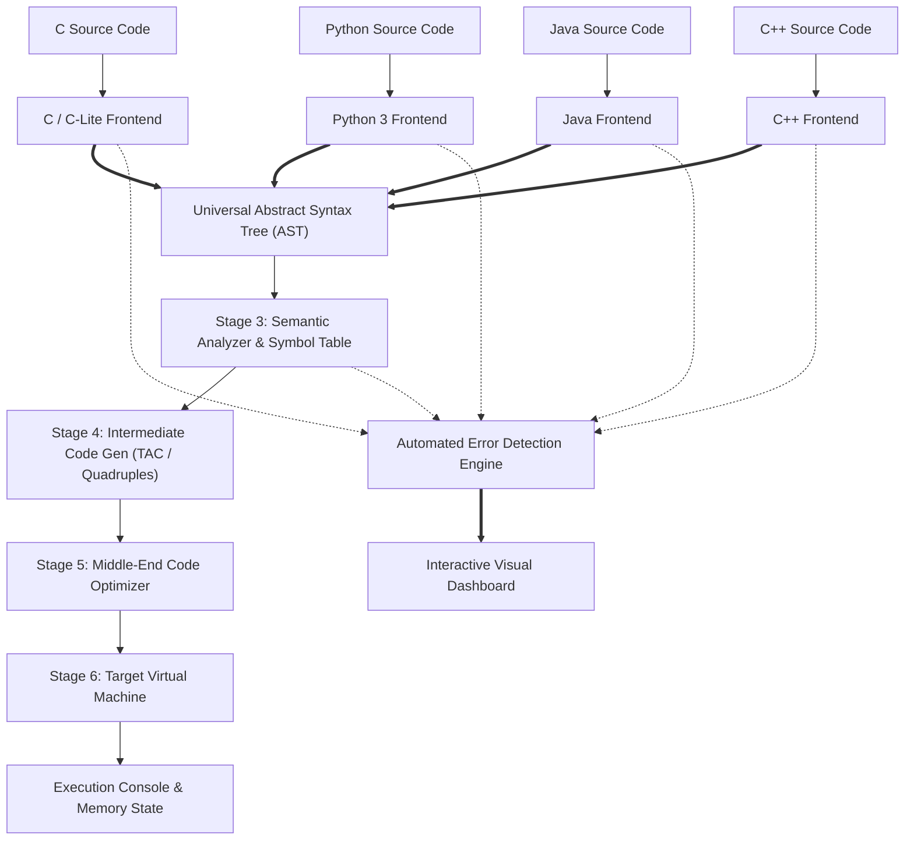

# Universal Multi-Language Visual Compiler System (C, Python, Java, C++)

An educational, industrial-grade visual compiler and execution environment featuring **Multi-Language Frontends** converging into a **Universal Abstract Syntax Tree (AST)** and **Three-Address Code (TAC)** pipeline.

---

## 📌 Architecture: Universal Multi-Language Compilation

Similar to modern industrial compiler frameworks like **GCC**, **LLVM**, and **GraalVM**, this compiler implements a decoupled **Multi-Language Frontend Architecture**:



---

## 🌐 Supported Languages & Frontends

| Language | Frontend Module | Supported Constructs | Sample File |
| :--- | :--- | :--- | :--- |
| **C / C-Lite** | [compiler/frontends/c_frontend.py](file:///e:/COMPLIER%20DESIGN/complier%20design%20capstone/compiler/frontends/c_frontend.py) | Preprocessor `#include`, standard types (`int`, `float`, `string`, `bool`), `printf`, loops, functions. | [samples/c/01_c_arithmetic.c](file:///e:/COMPLIER%20DESIGN/complier%20design%20capstone/samples/c/01_c_arithmetic.c) |
| **Python 3** | [compiler/frontends/python_frontend.py](file:///e:/COMPLIER%20DESIGN/complier%20design%20capstone/compiler/frontends/python_frontend.py) | Python indentation (`INDENT`/`DEDENT`), dynamic assignment, `print()`, `def`, `while`, `if`/`else`. | [samples/python/01_py_fibonacci.py](file:///e:/COMPLIER%20DESIGN/complier%20design%20capstone/samples/python/01_py_fibonacci.py) |
| **Java** | [compiler/frontends/java_frontend.py](file:///e:/COMPLIER%20DESIGN/complier%20design%20capstone/compiler/frontends/java_frontend.py) | `public class Main`, `public static void main(String[] args)`, `System.out.println()`, typed variables, loops. | [samples/java/01_java_sum.java](file:///e:/COMPLIER%20DESIGN/complier%20design%20capstone/samples/java/01_java_sum.java) |
| **C++** | [compiler/frontends/cpp_frontend.py](file:///e:/COMPLIER%20DESIGN/complier%20design%20capstone/compiler/frontends/cpp_frontend.py) | `#include <iostream>`, `using namespace std;`, `cout << expr << endl;`, typed functions, control flow. | [samples/cpp/01_cpp_iostream.cpp](file:///e:/COMPLIER%20DESIGN/complier%20design%20capstone/samples/cpp/01_cpp_iostream.cpp) |

---

## 🚀 Running the Compiler

### 1. In the Web Browser
Start the local server:
```bash
python server.py
```
Open **[http://localhost:8000](http://localhost:8000)** in your browser:
* Use the **Language Selector** dropdown in the header to switch between **C**, **Python 3**, **Java**, and **C++**.
* Select any language sample from the **Samples** dropdown and click **Compile & Run**.
* Compare how different source languages produce the same clean **Universal AST**, **Three-Address Code (TAC)**, and **Optimized Execution Trace**!

### 2. From the Command Line (CLI)
```powershell
# Compile & execute Python source code
python cli.py samples/python/01_py_fibonacci.py --all

# Compile & execute Java source code
python cli.py samples/java/01_java_sum.java --all

# Compile & execute C++ source code
python cli.py samples/cpp/01_cpp_iostream.cpp --all

# Compile & execute C source code
python cli.py samples/c/01_c_arithmetic.c --all

# Run complete unit test suite (19/19 passing)
python -m unittest discover tests
```
